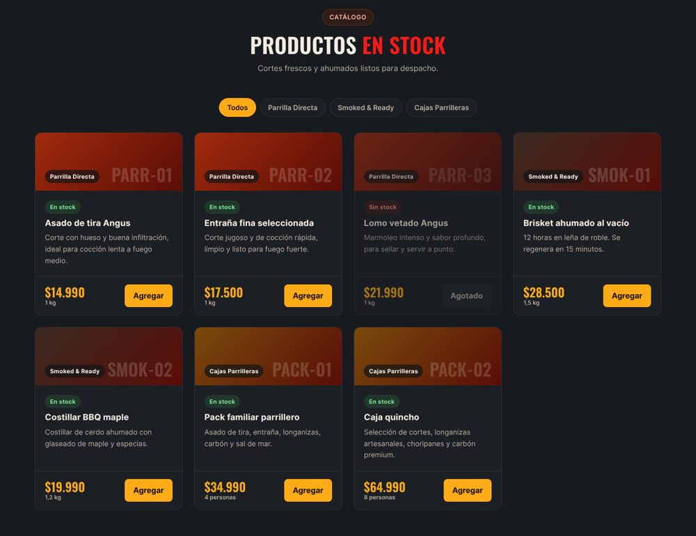
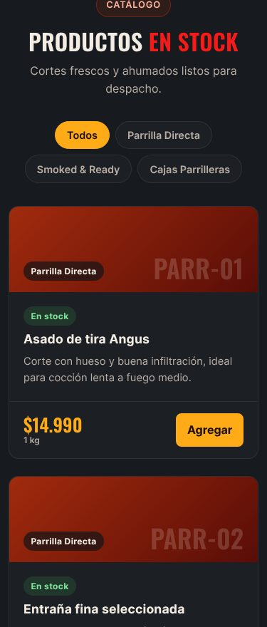
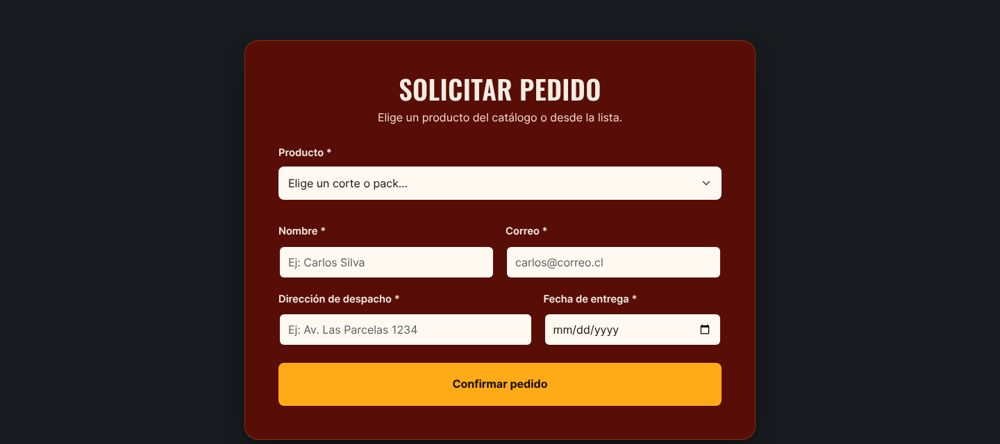
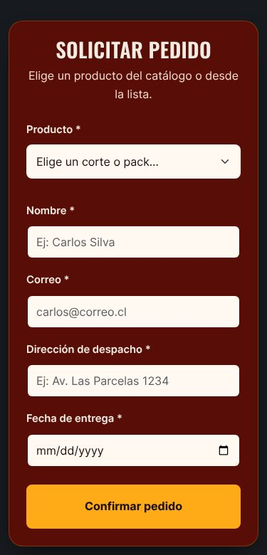
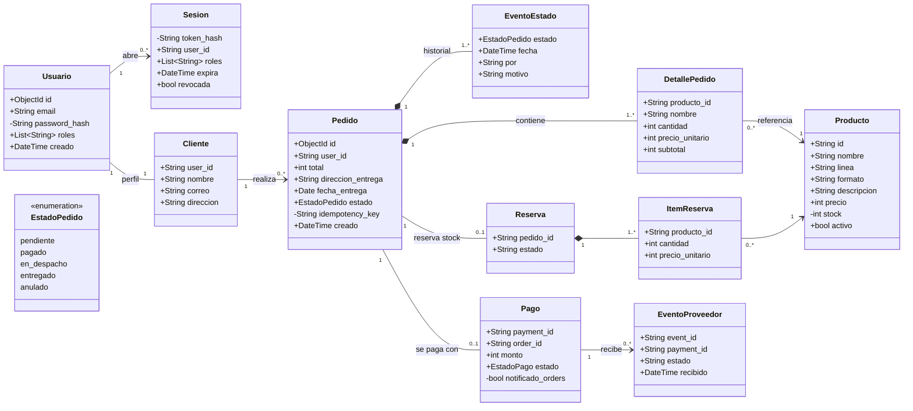
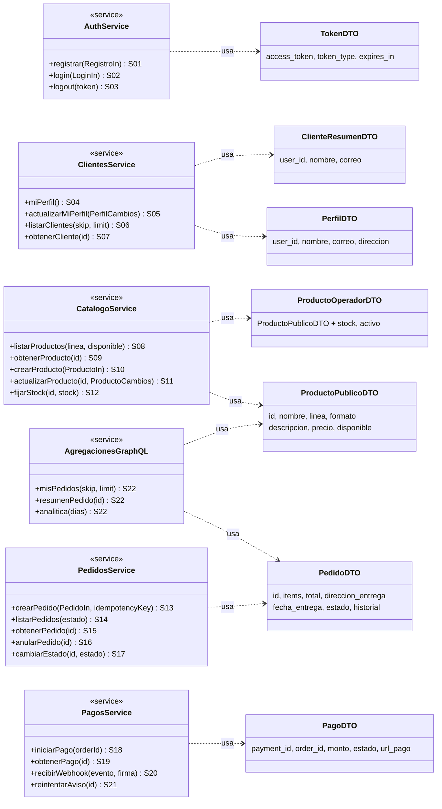
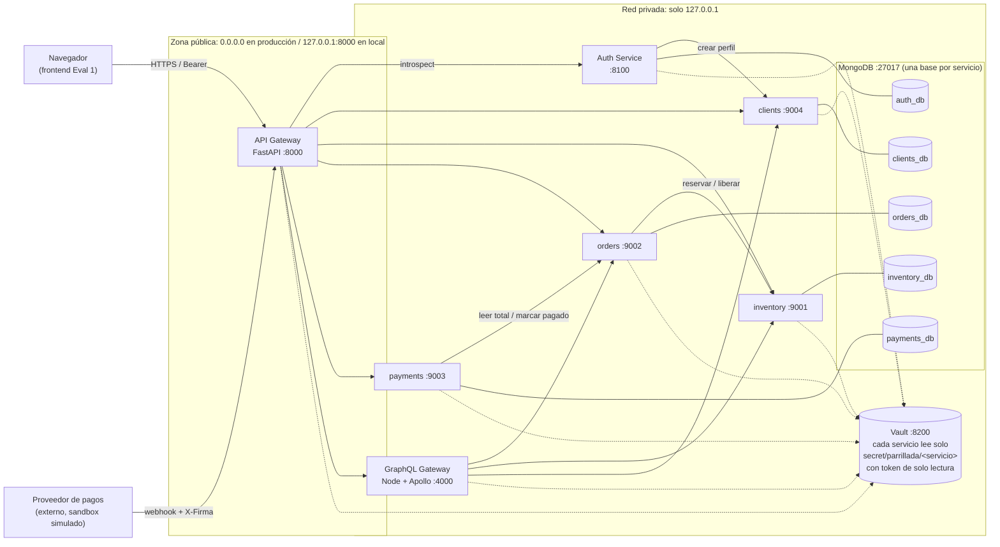
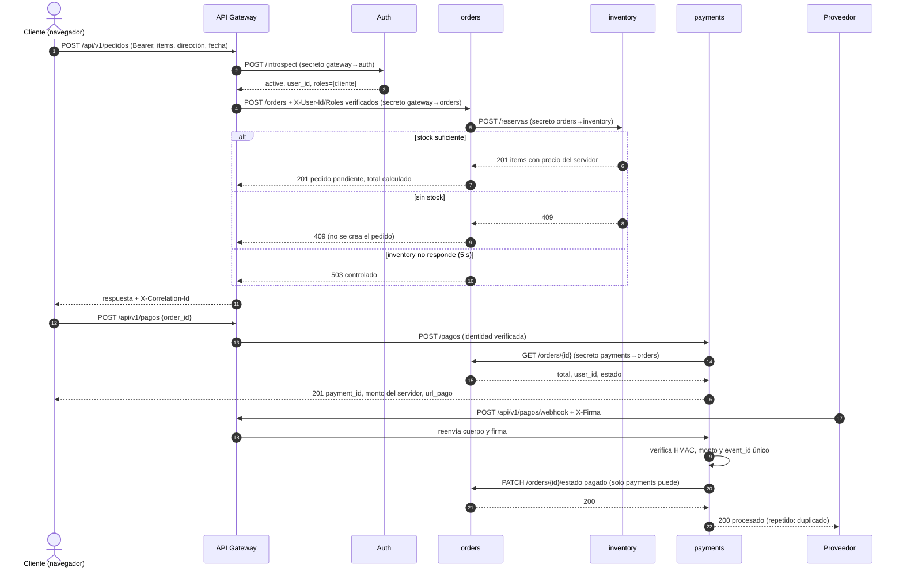
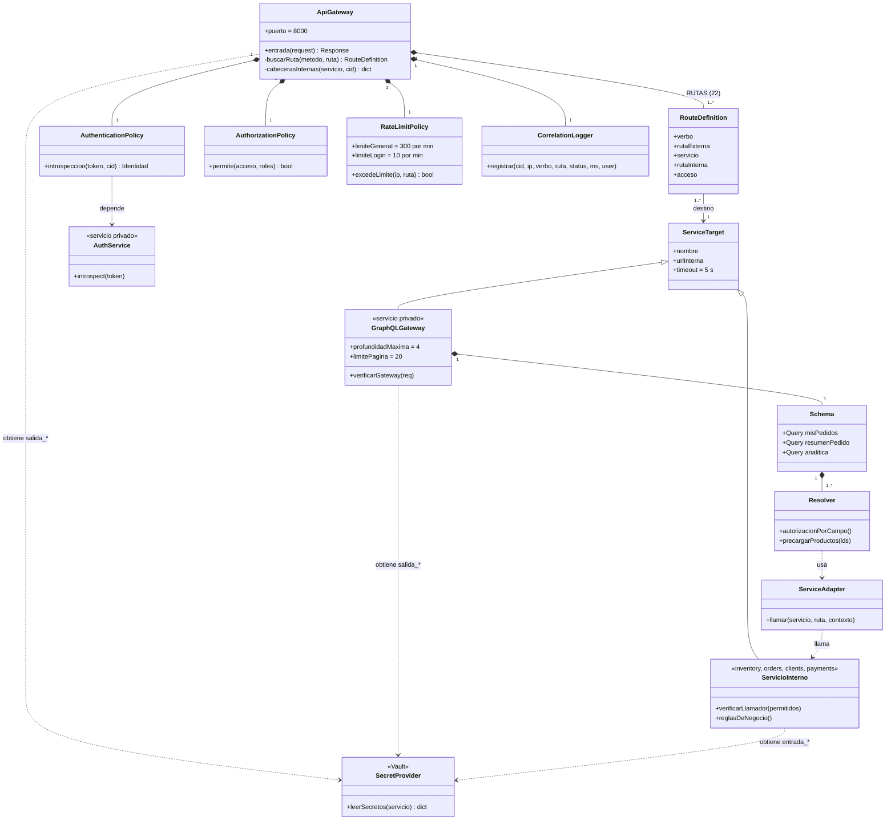

# Informe de arquitectura · Evaluación 2

**Backend seguro completo de "La Tienda del Fuego"**
Desarrollo Web y Mobile, UNAB · Entrega: 9 de noviembre de 2026

| | |
| --- | --- |
| Caso | Caso N.º 20 · Tienda parrillera con venta en línea y despacho a domicilio ("La Tienda del Fuego") |
| Integrantes | Agustín Pacheco (seguridad: API Gateway, Auth, Vault, clients, payments) · David León (inventory, orders, GraphQL Gateway, analítica) |
| Versión del frontend | Evaluación 1 rediseñada, carpeta `parrillada/parrillada_frontend/` (Bootstrap 5 + JavaScript) |
| Código del backend | `parrillada/backend/`: `services/` (7 servicios), `vault/`, `datos/`, `tests/`, `iniciar.ps1`, `detener.ps1` |
| Cómo ejecutarlo | `parrillada/README.md` (puesta en marcha, detener, datos de prueba y pruebas) |

> **Alcance de la entrega.** Entregamos juntos el frontend de la Evaluación 1 y el backend de la Evaluación 2.
> Según lo acordado para esta evaluación, el frontend va sin integrar y el backend trabaja con **sus datos**: los
> 7 productos de `parrillada_frontend/data/productos.json` y los campos de su formulario de pedido. Todos los
> flujos los demostramos contra el backend real por el API Gateway, que es la misma entrada que usaría el navegador
> (`tests/demo_flujos.py`, sección M10). Dejamos la capa de servicios separada en `parrillada_frontend/js/api.js`,
> así que integrarlo consiste en cambiar sus URLs por las del gateway.

## Contenido

0. [Punto de partida: requisitos, pantallas y brechas](#0-punto-de-partida)
1. [M1 · Servicios derivados del frontend](#m1--servicios-derivados-del-frontend)
2. [M2 · Clases y cardinalidades del dominio](#m2--clases-y-cardinalidades-del-dominio)
3. [M3 · Sistemas e integraciones](#m3--sistemas-e-integraciones)
4. [M4 · Stakeholders y permisos HTTP](#m4--stakeholders-y-permisos-http)
5. [M5 · Clases del API Gateway](#m5--clases-del-api-gateway)
6. [M6 · Rutas y secretos de integración](#m6--rutas-y-secretos-de-integración)
7. [M7 · Datos sensibles y secretos del cliente](#m7--datos-sensibles-y-secretos-del-cliente)
8. [M8 · Separación privada y agregaciones GraphQL](#m8--separación-privada-y-agregaciones-graphql)
9. [M9 · Analítica y gRPC](#m9--analítica-y-grpc)
10. [M10 · Backend completo y verificación](#m10--backend-completo-y-verificación)

En este informe, las rutas de código (`services/`, `tests/`, `vault/`, `datos/`, `iniciar.ps1`) son relativas a
`parrillada/backend/`, y las de documentación (`docs/`) a `parrillada/`.

Escribimos los diagramas en Mermaid dentro de este archivo (GitHub los dibuja) y también los dejamos como archivos
editables `.mmd` con su versión `.svg` en `docs/diagramas/`. Las evidencias de ejecución están en `docs/evidencias/`.

---

## 0. Punto de partida

### Requisitos del caso

| ID | Requisito | Origen |
| --- | --- | --- |
| R1 | Consultar el catálogo de cortes, ahumados y cajas, y filtrarlo por línea | Caso y pantalla P02 |
| R2 | Solicitar un pedido con producto, dirección de despacho y fecha de entrega | Caso y pantalla P03 |
| R3 | Pagar el pedido en línea con un proveedor de pagos | Caso |
| R4 | Tener una cuenta de cliente (registro, ingreso, perfil) para seguir los pedidos propios | Caso |
| R5 | Administrar catálogo y stock (operador de la tienda) | Caso |
| R6 | Gestionar el despacho: estados del pedido hasta la entrega, y anulación | Caso |
| R7 | Reporte de ventas para el operador | Caso (M9) |
| R8 | Proteger los datos personales del cliente y los secretos de integración | Pauta (M6, M7) |

### Pantallas existentes (escritorio y móvil)

| ID | Pantalla | Acciones |
| --- | --- | --- |
| P01 | Inicio (portada, estilos de parrilla, nosotros, FAQ) | Solo informativa; enlaza al catálogo y al pedido |
| P02 | Catálogo "Productos en stock" | Cargar productos, filtrar por línea, botón "Agregar" (preselecciona el producto en P03) |
| P03 | Solicitar pedido | Formulario: producto, nombre, correo, dirección de despacho, fecha de entrega → "Confirmar pedido" |
| P04 | Comprobante (panel bajo P03) | Muestra número y estado del pedido creado |

| Escritorio (1440 px) | Móvil (375 px) |
| --- | --- |
|  |  |
|  |  |

En móvil cambian la grilla (1 columna) y el menú (hamburguesa), pero las acciones son las mismas: una variación
visual no genera servicios nuevos.

### Brechas declaradas

Nuestro frontend de la Evaluación 1 no tiene pantallas para varias funciones del caso. **En el backend las implementamos
completas** y proponemos estas pantallas, que consumirían los servicios ya publicados:

| Brecha | Pantalla propuesta | Servicios que ya existen |
| --- | --- | --- |
| No hay registro ni ingreso | P05 Ingresar / Crear cuenta | S01, S02, S03 |
| No hay "mis pedidos" ni perfil | P06 Mi cuenta (perfil y pedidos) | S04, S05, S14, S15, S16, S22 |
| No hay pago | P07 Pago (redirige al proveedor) | S18, S19 |
| No hay administración | P08 Panel del operador (catálogo, stock, despacho, reportes) | S06, S07, S10, S11, S12, S17, S21, S22 |

El formulario de P03 pide nombre y correo porque en la Evaluación 1 todavía no teníamos cuentas. En el backend esos datos
pasan al registro (S01) y el pedido (S13) recibe solo productos, dirección y fecha; la identidad sale de la sesión.

---

## M1 · Servicios derivados del frontend

### Catálogo de servicios

Clasificación de datos: **Púb** = público, **Pers** = personal restringido, **Cred** = credencial.

| ID | Requisito | Pantalla y acción | Propósito | Verbo y ruta | Entrada | Salida | Reglas y errores | Datos | Acceso |
| --- | --- | --- | --- | --- | --- | --- | --- | --- | --- |
| S01 | R4 | P05 → crear cuenta (hoy: datos de P03) | Registrar cliente | `POST /api/v1/auth/registro` | nombre, correo, dirección, password | 201 `{user_id, correo, roles}` | 422 validación, 409 correo repetido, 503 si clients no responde (se deshace) | Pers, Cred | anónimo |
| S02 | R4 | P05 → ingresar | Iniciar sesión | `POST /api/v1/auth/login` | correo, password | 200 `{access_token, expires_in}` | 401 mismo mensaje si el correo no existe o la clave es mala; 429 tras 10 intentos/min | Cred | anónimo |
| S03 | R4 | P06 → cerrar sesión | Revocar sesión | `POST /api/v1/auth/logout` | Bearer | 200 | 401 sin sesión | Cred | autenticado |
| S04 | R4 | P06 → ver perfil | Perfil propio | `GET /api/v1/clientes/me` | Bearer | 200 `{nombre, correo, direccion}` | 401, 404 | Pers | autenticado |
| S05 | R4 | P06 → editar perfil | Actualizar perfil propio | `PUT /api/v1/clientes/me` | nombre, dirección | 200 perfil | 422; el correo no se cambia aquí | Pers | autenticado |
| S06 | R5 | P08 → clientes | Listar clientes | `GET /api/v1/clientes?skip&limit` | paginación (limit ≤ 100) | 200 `{items:[{user_id,nombre,correo}]}` sin dirección | 403 si no es operador | Pers | operador |
| S07 | R6 | P08 → ver cliente | Ficha de un cliente | `GET /api/v1/clientes/{id}` | id | 200 perfil | 403, 404 | Pers | operador |
| S08 | R1 | P02 → cargar y filtrar | Catálogo | `GET /api/v1/productos?linea&disponible` | filtros opcionales | 200 `[{id,nombre,linea,formato,descripcion,precio,disponible}]`; `[]` si no hay | 400 línea inválida. `stock` solo si el que consulta es operador | Púb | anónimo |
| S09 | R1 | P02/P03 → detalle | Un producto | `GET /api/v1/productos/{id}` | id | 200 producto | 404 inexistente o inactivo | Púb | anónimo |
| S10 | R5 | P08 → nuevo producto | Crear producto | `POST /api/v1/productos` | id `AAAA-00`, nombre, línea, formato, descripción, precio, stock | 201 | 409 código repetido, 400 línea, 403 | Púb | operador |
| S11 | R5 | P08 → editar | Reemplazar datos del producto | `PUT /api/v1/productos/{id}` | igual a S10 sin stock, con `activo` | 200 | 404, 403. Desactivar en vez de borrar | Púb | operador |
| S12 | R5 | P08 → stock | Fijar stock | `PATCH /api/v1/productos/{id}/stock` | stock ≥ 0 | 200 | 404, 403 | Púb | operador |
| S13 | R2 | P03 → confirmar pedido | Crear pedido | `POST /api/v1/pedidos` + `Idempotency-Key` opcional | items `[{producto_id, cantidad}]`, dirección, fecha | 201 pedido con precios y total del servidor | 409 sin stock, 422 fecha fuera de hoy..+60 días, 503 si inventory cae; total del navegador se ignora | Pers | cliente |
| S14 | R4, R6 | P06 / P08 → pedidos | Listar pedidos | `GET /api/v1/pedidos?estado&skip&limit` | filtros | 200 `{items,total}`: cliente solo los suyos, operador todos | 400 estado inválido | Pers | autenticado |
| S15 | R4, R6 | P04 / P06 → detalle | Un pedido | `GET /api/v1/pedidos/{id}` | id | 200 pedido | 404 si no existe **o es ajeno** | Pers | autenticado |
| S16 | R6 | P06 → anular | Anular (no borra) | `POST /api/v1/pedidos/{id}/anular` | id | 200 pedido `anulado`, stock liberado | 404 ajeno, 409 si ya no está pendiente | Pers | autenticado |
| S17 | R6 | P08 → despacho | Cambiar estado | `PATCH /api/v1/pedidos/{id}/estado` | estado `en_despacho`/`entregado`/`anulado`, motivo | 200 | 409 transición inválida, 403 (pagado solo lo marca payments) | Pers | operador |
| S18 | R3 | P07 → pagar | Iniciar pago | `POST /api/v1/pagos` | order_id | 201 `{payment_id, monto, estado, url_pago}` | monto leído de orders; 404 pedido ajeno; 409 si no está pendiente | Pers | cliente |
| S19 | R3 | P07 → estado del pago | Consultar pago | `GET /api/v1/pagos/{id}` | id | 200 pago | 404 ajeno | Pers | autenticado |
| S20 | R3 | (proveedor) | Aviso del proveedor | `POST /api/v1/pagos/webhook` + `X-Firma` | event_id, payment_id, estado, monto | 200 `procesado`/`duplicado`/`sin_cambios` | 401 firma inválida, 422 monto distinto | Púb | proveedor |
| S21 | R3, R6 | P08 → reintentar | Reenviar aviso a orders si falló | `POST /api/v1/pagos/{id}/reintentar-aviso` | id | 200 | 403, 404 | Púb | operador |
| S22 | R4, R6, R7 | P06 / P08 | Agregaciones | `POST /api/v1/graphql` | query `misPedidos`, `resumenPedido`, `analitica` | 200 `{data, errors}` | profundidad ≤ 4, página ≤ 20, campos por rol | Pers | autenticado |

No publicamos ningún `DELETE`: los productos se desactivan (S11) y los pedidos se anulan (S16) para conservar el
historial. No inventamos operaciones destructivas solo para completar un CRUD.

### Lo que envía el navegador y lo que decide el servidor

| El navegador envía | El servidor calcula o valida |
| --- | --- |
| `producto_id` y `cantidad` | precio unitario, nombre, subtotal y total (inventory al reservar) |
| `order_id` al pagar | monto del pago (leído de orders) |
| correo y password | rol `cliente` (nunca lo elige el usuario), identidad del token |
| nada sobre el estado del pago | estado `pagado`: solo por webhook firmado del proveedor |

### Ejemplos de contrato (datos ficticios)

```http
GET /api/v1/productos?linea=Smoked%20%26%20Ready          (anónimo)
200 OK
[{"id":"SMOK-02","nombre":"Costillar BBQ maple","linea":"Smoked & Ready","formato":"1,2 kg",
  "descripcion":"Costillar de cerdo ahumado con glaseado de maple y especias.","precio":19990,"disponible":true}]
```

```http
POST /api/v1/auth/registro
{"nombre":"Carlos Silva","correo":"carlos@correo.cl","direccion":"Av. Las Parcelas 1234","password":"********"}
201 Created
{"user_id":"6730c1f2a1b2c3d4e5f60718","correo":"carlos@correo.cl","roles":["cliente"]}
```

```http
POST /api/v1/pedidos
Authorization: Bearer <token>
Idempotency-Key: 3f2a9c1e
{"items":[{"producto_id":"SMOK-02","cantidad":2}],"direccion_entrega":"Av. Las Parcelas 1234","fecha_entrega":"2026-11-11","total":1}
201 Created
{"id":"6730c2a0...","items":[{"producto_id":"SMOK-02","nombre":"Costillar BBQ maple","cantidad":2,
 "precio_unitario":19990,"subtotal":39980}],"total":39980,"estado":"pendiente","direccion_entrega":"Av. Las Parcelas 1234",
 "fecha_entrega":"2026-11-11","historial":[{"estado":"pendiente","por":"cliente"}]}
```
(El `"total":1` enviado por el navegador se ignora.)

```http
POST /api/v1/pagos
{"order_id":"6730c2a0...","monto":1}
201 Created
{"payment_id":"b398be71-...","order_id":"6730c2a0...","monto":39980,"estado":"pendiente",
 "url_pago":"https://sandbox.proveedor.test/pagar/b398be71-..."}
```

```http
POST /api/v1/pagos/webhook
X-Firma: <HMAC-SHA256 del cuerpo>
{"event_id":"evt-001","payment_id":"b398be71-...","estado":"aprobado","monto":39980}
200 OK  {"resultado":"procesado","estado":"aprobado","pedido_notificado":true}
(mismo evento otra vez) 200 OK  {"resultado":"duplicado","estado":"aprobado"}
```

```http
POST /api/v1/graphql
{"query":"{ misPedidos(limit: 5) { total items { id estado total items { nombre cantidad producto { linea disponible } } } } }"}
200 OK
{"data":{"misPedidos":{"total":1,"items":[{"id":"6730c2a0...","estado":"pagado","total":39980,
 "items":[{"nombre":"Costillar BBQ maple","cantidad":2,"producto":{"linea":"Smoked & Ready","disponible":true}}]}]}}}
```

Errores: todos responden `{"detail": "...", "correlation_id": "..."}` con un mensaje controlado, sin trazas internas.

---

## M2 · Clases y cardinalidades del dominio

### Diagrama UML del dominio



Leyenda: `+` atributo que puede salir en una respuesta, `-` atributo interno que nunca sale; `*--` composición
(la parte no existe sin el todo); `-->` asociación navegable; `"1"`, `"0..1"`, `"0..*"`, `"1..*"` multiplicidades.

### Tabla de relaciones

| Origen | Destino | Multiplicidad | Regla del negocio que la respalda |
| --- | --- | --- | --- |
| Usuario | Sesion | 1 — 0..* | Un usuario puede tener varias sesiones (varios dispositivos); cada sesión es de un solo usuario. Las vencidas las borra un índice TTL. |
| Usuario | Cliente | 1 — 1 | Al registrarse se crea la identidad (auth) y su perfil (clients). Si el perfil falla, se deshace la identidad: nunca queda uno sin el otro. |
| Cliente | Pedido | 1 — 0..* | Un cliente puede no haber comprado nunca; cada pedido pertenece a un solo cliente (`user_id`). |
| Pedido | DetallePedido | 1 — 1..* (composición) | Un pedido confirmado tiene al menos un ítem; no existe borrador vacío porque no hay carrito persistente. |
| Pedido | EventoEstado | 1 — 1..* (composición) | Se crea con el evento `pendiente` y cada cambio agrega uno: es el historial que permite anular sin borrar. |
| DetallePedido | Producto | 0..* — 1 | Cada detalle refiere a un producto; un producto puede estar en muchos detalles. El nombre y el precio se **copian** al detalle, así el historial no cambia si después cambia el precio o el producto se desactiva. |
| Pedido | Reserva | 1 — 0..1 | Hay a lo más una reserva por pedido (índice único en `pedido_id`): reintentar no descuenta dos veces. |
| Reserva | ItemReserva | 1 — 1..* | Una reserva descuenta al menos un producto. |
| Pedido | Pago | 1 — 0..1 | Un pedido pendiente puede no tener pago aún; si se inicia de nuevo se devuelve el mismo pago abierto. Un pago rechazado anula el pedido, por eso no hay un segundo pago. |
| Pago | EventoProveedor | 1 — 0..* | El proveedor puede reenviar el aviso varias veces; cada `event_id` se guarda una sola vez (idempotencia). |

**Decisiones:** decidimos que el carrito no sea una clase persistida (el frontend elige el producto y confirma en un solo paso).
Los productos no se borran, se desactivan, para que los pedidos antiguos sigan mostrando qué se compró.

### Servicios públicos y DTO



Las flechas punteadas son **dependencias de uso de un contrato**, no relaciones entre registros: no significan que
exista un producto por cada instancia del servicio.

**Modelo interno vs DTO:** `password_hash`, `token_hash`, `stock` (para el público), `idempotency_key` y
`notificado_orders` nunca salen. El listado de clientes del operador (`ClienteResumenDTO`) no lleva la dirección.
GraphQL entrega a otros servicios solo el `nombre` del cliente.

### Correspondencia operación UML ↔ servicio

Cada operación de los diagramas lleva su ID (S01 a S22). Las 22 filas del catálogo del M1 están representadas;
`S22` agrupa las tres consultas GraphQL.

---

## M3 · Sistemas e integraciones

### Matriz de sistemas

| Sistema | Responsabilidad | Datos que administra (autoridad) | Servicios | Dependencias | Contrato de integración | Credencial requerida | Respuesta ante fallos |
| --- | --- | --- | --- | --- | --- | --- | --- |
| **inventory** | Catálogo, stock y reservas | `inventory_db`: productos, stock, reservas. **Única autoridad del stock** | S08 a S12 | ninguna | REST: `POST /reservas`, `POST /reservas/{id}/liberar`, `GET /productos?ids=` (lote) | secreto de tramo `gateway`, `orders`, `graphql` | reserva atómica; si no alcanza un ítem se devuelve lo descontado y responde 409 |
| **orders** | Pedidos y su ciclo de vida | `orders_db`: pedidos, ítems, historial. **Única autoridad del estado del pedido** | S13 a S17 | inventory | REST: reserva al crear, libera al anular; expone `GET /orders/{id}` a payments y `GET /orders/analitica` a graphql | secreto `gateway`, `payments`, `graphql`; usa `salida_inventory` | inventory caído → 503, el pedido no se crea; si falla el guardado, libera la reserva |
| **clients** | Perfil del cliente | `clients_db`: nombre, correo, dirección | S04 a S07 | ninguna | REST; `POST /clientes` solo desde auth | secreto `gateway`, `auth`, `graphql` | 404 si no hay perfil |
| **payments** | Inicio de pago y aviso del proveedor | `payments_db`: pagos, eventos del proveedor | S18 a S21 | orders, proveedor | REST a orders (leer total, cambiar estado); webhook firmado HMAC | secreto `gateway`; usa `salida_orders`; `clave_webhook` | orders caído → 503 al iniciar; si cae al notificar, queda `notificado_orders=false` y el operador reintenta (S21) |
| auth | Identidad, contraseñas y sesiones | `auth_db`: usuarios, sesiones | S01 a S03 | clients | REST: `/registro`, `/login`, `/introspect`, `/logout` | secreto `gateway`; usa `salida_clients` | clients caído → se deshace el registro (compensación) y responde 503 |
| graphql | Agregaciones de solo lectura | ninguna (no tiene base) | S22 | orders, inventory, clients | GraphQL hacia afuera, REST hacia adentro | secreto `gateway`; usa `salida_orders/inventory/clients` | error parcial con `SERVICIO_NO_DISPONIBLE` |
| API Gateway | Única entrada pública | ninguno | todas | auth y todos los destinos | lista explícita de rutas | lee `salida_*` de Vault | 503/504 controlados |
| Vault | Gestor de secretos | secretos de tramo y clave del webhook | — | — | KV v2 por HTTP, un token de solo lectura por servicio | token de servicio | si cae, los servicios siguen con lo cargado; uno que reinicia no arranca (falla cerrado) |
| Proveedor de pagos | **Externo** (adaptador de prueba) | estado del cobro | — | payments | webhook firmado | `clave_webhook` | reenvía el aviso; payments lo procesa una sola vez |

Mantuvimos separados auth y clients (como en el DSL del curso): la identidad y la contraseña quedan en
`auth_db`, los datos personales en `clients_db`. No dividimos más (por ejemplo, un servicio por tabla) porque
cada sistema es dueño de un conjunto cohesionado de datos.

### Mapa de componentes y despliegue



Las flechas continuas son **flujos de red** (quién llama a quién); cada flecha interna usa su propio secreto de tramo. Las punteadas son la lectura de secretos en Vault al iniciar cada servicio.

### Secuencia representativa: compra y pago



---

## M4 · Stakeholders y permisos HTTP

### Registro de stakeholders

| Stakeholder | Interés | Rol o identidad | Uso de la información |
| --- | --- | --- | --- |
| Visitante | Ver productos y precios | `anonimo` | Solo catálogo público (S08, S09) |
| Cliente | Comprar y seguir sus pedidos | `cliente` | Su perfil, sus pedidos y sus pagos |
| Operador de la tienda | Mantener catálogo, stock y despacho; ver ventas | `operador` | Administración (S06, S07, S10 a S12, S17, S21) y reporte `analitica` |
| Proveedor de pagos | Informar el resultado del cobro | identidad técnica `proveedor` (firma HMAC) | Solo S20 |
| Servicios internos | Colaborar entre sistemas | identidades técnicas `gateway`, `auth`, `orders`, `payments`, `graphql` | Solo los tramos de la tabla del M6 |
| Repartidor | Entregar el pedido | **sin permisos operativos** | Recibe del operador la hoja de despacho (dirección y fecha). No tiene cuenta en el sistema. |
| Dueños de la tienda | Resultados del negocio | **sin permisos operativos** | Reciben del operador el reporte de ventas (montos agregados, sin datos personales). |
| Docente / evaluador | Revisar la solución | **sin permisos operativos** | Código, informe y evidencias. |

Identidad (quién es: token verificado por auth) y autorización (qué puede hacer: rol de la ruta + propiedad del
recurso) se revisan por separado.

### Matriz de verbos por servicio

P = permitido, D = denegado, — = no aplicable (verbo no publicado, responde 404).

| Recurso | Rol | GET | POST | PUT | PATCH | DELETE |
| --- | --- | --- | --- | --- | --- | --- |
| `/productos` | anónimo / cliente | P | D | D | D | — |
| `/productos` | operador | P (con stock) | P | P | P (stock) | — |
| `/clientes/me` | cliente / operador | P (propio) | — | P (propio) | — | — |
| `/clientes`, `/clientes/{id}` | cliente | D | — | — | — | — |
| `/clientes`, `/clientes/{id}` | operador | P | — | — | — | — |
| `/pedidos` | cliente | P (propios) | P | — | D | — |
| `/pedidos` | operador | P (todos) | D | — | P (estado) | — |
| `/pedidos/{id}/anular` | cliente | — | P (propio y pendiente) | — | — | — |
| `/pagos` | cliente | P (propios) | P (pedido propio) | — | — | — |
| `/pagos/webhook` | proveedor | — | P (firma válida) | — | — | — |
| `/graphql` | cliente / operador | — | P (por operación y campo) | — | — | — |

### Matriz de permisos por ruta y condición

| Rol o identidad | ID | Ruta | Verbo | Decisión | Alcance y condición | Dónde se verifica |
| --- | --- | --- | --- | --- | --- | --- |
| Visitante | S08 | `/api/v1/productos` | GET | Permitido | Solo campos públicos, sin `stock` | Gateway (ruta anónima) + inventory (`producto_publico`) |
| Visitante | S13 | `/api/v1/pedidos` | POST | Denegado 401 | Requiere sesión | Gateway |
| Cliente | S13 | `/api/v1/pedidos` | POST | Permitido | Rol `cliente`; total del servidor; stock disponible | Gateway (rol) + orders (rol, fecha) + inventory (stock) |
| Cliente | S15 | `/api/v1/pedidos/{id}` | GET | Permitido | Solo si `pedido.user_id` = usuario; si no, 404 | orders |
| Cliente | S16 | `/api/v1/pedidos/{id}/anular` | POST | Permitido | Propio y en estado `pendiente` | orders (propiedad + `TRANSICIONES`) |
| Cliente | S17 | `/api/v1/pedidos/{id}/estado` | PATCH | Denegado 403 | Solo operador | Gateway + orders (`PERMISO_ESTADO`) |
| Cliente | S10 | `/api/v1/productos` | POST | Denegado 403 | Consultar el catálogo no da permisos de administración | Gateway + inventory (`exigir_operador`) |
| Cliente | S06 | `/api/v1/clientes` | GET | Denegado 403 | Solo operador | Gateway + clients |
| Cliente | S18 | `/api/v1/pagos` | POST | Permitido | Pedido propio y `pendiente`; monto desde orders | payments |
| Cliente | S19 | `/api/v1/pagos/{id}` | GET | Permitido | Solo pago propio (404 si no) | payments |
| Cliente | S22 | `/api/v1/graphql` `misPedidos` | POST | Permitido | Siempre filtra por su `user_id` | graphql + orders |
| Cliente | S22 | `analitica` / campo `stock` | POST | Denegado | `Campo restringido` / `Requiere rol operador` | graphql (resolver) |
| Operador | S13, S18 | `/api/v1/pedidos`, `/api/v1/pagos` | POST | Denegado 403 | Comprar y pagar es exclusivo del rol `cliente` | Gateway (rol) + orders (`crear_pedido`) |
| Operador | S10–S12 | `/api/v1/productos…` | POST/PUT/PATCH | Permitido | Línea válida, código único | Gateway + inventory |
| Operador | S17 | `/api/v1/pedidos/{id}/estado` | PATCH | Permitido | `pagado→en_despacho→entregado`, o `pendiente→anulado`; no puede marcar `pagado` | orders |
| Operador | S07 | `/api/v1/clientes/{id}` | GET | Permitido | Ficha completa para despacho | Gateway + clients |
| Proveedor | S20 | `/api/v1/pagos/webhook` | POST | Permitido | Firma HMAC válida y monto igual al del pago | payments |
| payments (servicio) | — | orders `PATCH /orders/{id}/estado` | PATCH | Permitido | Solo `pagado` o `anulado` | orders (`PERMISO_ESTADO`) |
| Cualquiera | — | servicio interno directo (ej. `:9002`) | todos | Denegado 403 | Sin secreto de tramo válido | cada servicio (`verificar_llamador`) |

La matriz permite comprobar que un usuario no consulta pedidos de otro: la condición la aplica **orders** con el
`user_id` verificado, no el frontend (prueba `test_pedido_ajeno_404_sin_revelar_datos`).

**Solo el cliente compra:** decidimos que el operador administra el catálogo y el despacho, pero no crea pedidos
ni paga con su cuenta. Por eso `POST /api/v1/pedidos` y `POST /api/v1/pagos` exigen el rol `cliente` en el
gateway, y orders lo vuelve a comprobar en `crear_pedido` (403 si no corresponde). Si un trabajador quiere
comprar, lo hace con una cuenta de cliente.

**Anular no es borrar:** el pedido pasa a `anulado`, se agrega un evento al historial y se libera la reserva de
stock. El registro se conserva para la trazabilidad y la contabilidad.

---

## M5 · Clases del API Gateway

### Decisión: un solo API Gateway

Elegimos un solo gateway: las rutas se separan por política (anónimo, autenticado, cliente, operador, proveedor) dentro
de la misma lista. Un segundo gateway (por ejemplo, uno solo para el operador) no aporta seguridad adicional en
este caso y duplicaría la configuración. El **GraphQL Gateway** es un componente distinto y **privado**: solo se
alcanza a través del API Gateway.

### Diagrama UML del gateway y sus políticas



Relaciones estructurales (`*--`, `-->`, `<|--`) describen la configuración; las dependencias (`..>`) indican uso en
ejecución. Los flujos de red están en el mapa del M3. Implementación: `services/gateway/main.py` (en el código las clases del
diagrama son funciones y la lista `RUTAS`; las modelamos como clases para mostrar responsabilidades).

### Qué valida cada uno

| API Gateway | Cada servicio interno |
| --- | --- |
| La ruta y el verbo existen en `RUTAS` (si no, 404) | Que el llamador sea un tramo permitido con su secreto (`verificar_llamador`, si no 403) |
| Token válido con auth (401) y rol de la ruta (403) | Rol otra vez (defensa en profundidad) y **propiedad** del recurso |
| Rate limit por IP (429) | Reglas de negocio: stock, transiciones, montos, fechas |
| Timeout 5 s → 504, servicio caído → 503 | Validación del cuerpo (Pydantic, 422) |
| Descarta `X-User-*` del navegador y arma las verificadas | No confía en `X-User-*` si el tramo no es el del gateway |
| `X-Correlation-Id` y log sin tokens | Mensajes de error sin detalles internos |

### Fronteras de confianza

1. **Internet → API Gateway:** nada del navegador es confiable (cabeceras, precios, montos, roles).
2. **API Gateway → servicios privados:** cada tramo se autentica con su propio secreto; la identidad del usuario
   viaja en cabeceras armadas por el gateway.
3. **Servicio → Vault:** cada servicio lee solo su ruta con un token de política de solo lectura.
4. **Proveedor → payments:** la confianza la da la firma HMAC, no la red.

### Recorrido de una solicitud autorizada y una denegada

- **Autorizada** (`GET /api/v1/pedidos/{id}` por su dueño): rate limit OK → ruta encontrada (`autenticado`) →
  introspección activa → el gateway arma `X-User-Id` → orders verifica el secreto del tramo `gateway` y que
  `pedido.user_id` coincide → 200. Log: `cid=20557fc3… GET /api/v1/pedidos/6af2… -> 200 35ms user=6af20b81…`.
- **Denegada** (el mismo pedido pedido por otra cuenta): mismos pasos hasta orders, que ve otro `user_id` →
  404 sin datos. Log: `cid=d35b148f… GET /api/v1/pedidos/6af2… -> 404 31ms user=6af20b82…`.
- **Denegada en el borde** (`DELETE /api/v1/pedidos/{id}`): el verbo no está en `RUTAS` → 404 sin llegar a orders.

---

## M6 · Rutas y secretos de integración

### Matriz de rutas (gateway externo, `services/gateway/main.py` → `RUTAS`)

| ID | Verbo | Ruta externa | Acceso | Sistema y ruta destino | Controles | Credencial del tramo |
| --- | --- | --- | --- | --- | --- | --- |
| S01 | POST | `/api/v1/auth/registro` | anónimo | auth `POST /registro` | rate limit, validación, rol fijo `cliente` | `gateway→auth` |
| S02 | POST | `/api/v1/auth/login` | anónimo | auth `POST /login` | límite 10/min por IP, bcrypt | `gateway→auth` |
| S03 | POST | `/api/v1/auth/logout` | autenticado | auth `POST /logout` | el token lo pone el gateway en el cuerpo | `gateway→auth` |
| S04 | GET | `/api/v1/clientes/me` | autenticado | clients `GET /clientes/me` | identidad verificada | `gateway→clients` |
| S05 | PUT | `/api/v1/clientes/me` | autenticado | clients `PUT /clientes/me` | correo no editable | `gateway→clients` |
| S06 | GET | `/api/v1/clientes` | operador | clients `GET /clientes` | sin dirección, limit ≤ 100 | `gateway→clients` |
| S07 | GET | `/api/v1/clientes/{id}` | operador | clients `GET /clientes/{id}` | rol revisado en clients | `gateway→clients` |
| S08 | GET | `/api/v1/productos` | anónimo | inventory `GET /productos` | filtros validados, campos públicos | `gateway→inventory` |
| S09 | GET | `/api/v1/productos/{id}` | anónimo | inventory `GET /productos/{id}` | `{id}` sin `/` ni `..`, máx. 64 | `gateway→inventory` |
| S10 | POST | `/api/v1/productos` | operador | inventory `POST /productos` | `exigir_operador` | `gateway→inventory` |
| S11 | PUT | `/api/v1/productos/{id}` | operador | inventory `PUT /productos/{id}` | idem | `gateway→inventory` |
| S12 | PATCH | `/api/v1/productos/{id}/stock` | operador | inventory `PATCH /productos/{id}/stock` | idem | `gateway→inventory` |
| S13 | POST | `/api/v1/pedidos` | cliente | orders `POST /orders` | `Idempotency-Key`, total del servidor | `gateway→orders` (+ `orders→inventory`) |
| S14 | GET | `/api/v1/pedidos` | autenticado | orders `GET /orders` | filtro por dueño | `gateway→orders` |
| S15 | GET | `/api/v1/pedidos/{id}` | autenticado | orders `GET /orders/{id}` | propiedad, 404 | `gateway→orders` |
| S16 | POST | `/api/v1/pedidos/{id}/anular` | autenticado | orders `POST /orders/{id}/anular` | propiedad, transición | `gateway→orders` (+ `orders→inventory`) |
| S17 | PATCH | `/api/v1/pedidos/{id}/estado` | operador | orders `PATCH /orders/{id}/estado` | `PERMISO_ESTADO`, `TRANSICIONES` | `gateway→orders` |
| S18 | POST | `/api/v1/pagos` | cliente | payments `POST /pagos` | monto desde orders | `gateway→payments` (+ `payments→orders`) |
| S19 | GET | `/api/v1/pagos/{id}` | autenticado | payments `GET /pagos/{id}` | propiedad | `gateway→payments` |
| S20 | POST | `/api/v1/pagos/webhook` | proveedor | payments `POST /pagos/webhook` | sin Bearer; solo pasa `X-Firma`; HMAC, idempotencia | `gateway→payments` + `clave_webhook` |
| S21 | POST | `/api/v1/pagos/{id}/reintentar-aviso` | operador | payments `POST /pagos/{id}/reintentar-aviso` | rol revisado en payments | `gateway→payments` (+ `payments→orders`) |
| S22 | POST | `/api/v1/graphql` | autenticado | graphql `POST /graphql` | profundidad, paginación, campos por rol | `gateway→graphql` |

Cualquier otra ruta o verbo responde 404 (no hay proxy genérico). Rutas solo internas (no publicadas):
`/introspect`, `POST /clientes`, `/reservas`, `/reservas/{id}/liberar`, `/orders/analitica`.

### Operaciones GraphQL

| Operación | Tipo | Campos autorizados | Resolver | Subsistemas consultados |
| --- | --- | --- | --- | --- |
| `misPedidos(skip, limit ≤ 20)` | Query | todos los del propio usuario; `stock` solo operador | `Query.misPedidos` + `ItemPedido.producto` | orders (`solo_propios=true`), inventory (una llamada en lote) |
| `resumenPedido(id)` | Query | dueño u operador; `direccionEntrega` y `cliente` restringidos | `Query.resumenPedido`, `Pedido.cliente` | orders, inventory, clients (solo `nombre`) |
| `analitica(dias 1..365)` | Query | solo operador | `Query.analitica`, `TopProducto.producto` | orders (`/orders/analitica`), inventory |

No hay `Mutation`: las escrituras pasan por los servicios REST, donde están las reglas transaccionales.

### gRPC

No aplica (ver M9 y `docs/ADR-001-analitica-y-grpc.md`): no hay métodos gRPC que documentar.

### Credencial del usuario vs credencial entre sistemas

- **Usuario:** token Bearer opaco de 32 bytes aleatorios emitido por auth. En `auth_db` se guarda solo su
  SHA-256; expira a los 30 min (índice TTL) y el logout lo revoca.
- **Entre sistemas:** `X-Service-Name` + `X-Service-Secret`, un secreto distinto por tramo, comparado con
  `secrets.compare_digest`. Es el patrón `verify_gateway` del curso, generalizado a cada tramo.
- **Identidad conservada:** el gateway arma `X-User-Id` y `X-User-Roles` desde la introspección. Los servicios
  solo las aceptan si el tramo autenticado es `gateway` (o `graphql`, que las recibe del gateway).

### Inventario de secretos (referencias simbólicas, sin valores)

| Referencia | Tipo | Emisor | Consumidor | Finalidad | Ubicación segura | Alcance | Rotación y revocación |
| --- | --- | --- | --- | --- | --- | --- | --- |
| `gateway.salida_auth` = `auth.entrada_gateway` | secreto de tramo | `vault/cargar_secretos.py` | gateway → auth | introspección, registro, login | Vault KV v2 | 1 tramo | re-ejecutar el script y reiniciar |
| `gateway.salida_{clients,inventory,orders,payments,graphql}` | secreto de tramo (5) | idem | gateway → cada servicio | reenviar solicitudes autorizadas | Vault | 1 tramo c/u | idem |
| `auth.salida_clients` | secreto de tramo | idem | auth → clients | crear el perfil al registrar | Vault | 1 tramo | idem |
| `orders.salida_inventory` | secreto de tramo | idem | orders → inventory | reservar y liberar stock | Vault | 1 tramo | idem |
| `payments.salida_orders` | secreto de tramo | idem | payments → orders | leer total, marcar pagado/anulado | Vault | 1 tramo | idem |
| `graphql.salida_{orders,inventory,clients}` | secreto de tramo (3) | idem | graphql → servicios | agregaciones de lectura | Vault | 1 tramo c/u | idem |
| `payments.clave_webhook` = `proveedor.clave_webhook` | clave HMAC | idem | payments y proveedor | verificar el aviso de pago | Vault | solo el webhook | idem |
| Token de Vault por servicio (8) | token con política `read` sobre `secret/data/parrillada/<servicio>` | script | cada servicio | leer sus secretos al arrancar | archivo `.tokens` local (en `.gitignore`) | 1 ruta, 24 h | el script revoca los anteriores |
| Token root de Vault (dev) | administrador | Vault | solo el script de carga | crear políticas y secretos | variable de entorno de la terminal | todo | cambia al reiniciar Vault dev |
| `OPERADOR_PASSWORD` | credencial de usuario de prueba | equipo | `datos/cargar_datos.py`, pruebas | crear el operador | variable de entorno | 1 usuario | re-ejecutar el script de datos |
| Conexión a Mongo | URI sin credenciales (local) | — | cada servicio, solo su base | persistencia | variable `MONGO_URI` | 1 base por servicio | ver limitaciones |

Total: **12 tramos con secretos distintos**. Si un tramo no está en la lista, no existe secreto para él y el destino
lo rechaza. La credencial de payments solo sirve para orders y solo puede pedir `pagado` o `anulado`.
Ningún secreto está en el código, en el frontend, en rutas, en parámetros de consulta ni en logs.

### Si una clave se filtra o Vault no responde

- **Filtración:** se ejecuta `vault/cargar_secretos.py` (genera todo de nuevo y revoca los tokens anteriores) y se
  reinician los servicios con `iniciar.ps1`. Una sesión de usuario filtrada se revoca con logout o vence en 30 min.
- **Vault caído:** los servicios leen sus secretos solo al arrancar y siguen funcionando con ellos en memoria. Un
  servicio que se reinicia sin Vault **no arranca** (falla cerrado; nunca usa un valor por defecto).
- **TLS:** en local la comunicación es HTTP en `127.0.0.1`. En un despliegue real el gateway iría detrás de HTTPS y
  los tramos internos con TLS (limitación declarada en el README).

---

## M7 · Datos sensibles y secretos del cliente

### Matriz de datos y credenciales

| Dato o credencial | Finalidad | Clasificación | Sistema custodio | Roles autorizados | Representación en el frontend | Protección | Retención |
| --- | --- | --- | --- | --- | --- | --- | --- |
| Producto (nombre, precio, descripción, línea, disponible) | Vender | Público | inventory | todos | P02, P03 | solo lectura para el público | indefinida (se desactiva, no se borra) |
| Stock exacto | Gestión | Interno | inventory | operador | no se muestra (solo "en stock") | campo por rol en REST y GraphQL | indefinida |
| Nombre | Identificar al cliente y su pedido | Personal | clients | dueño, operador; GraphQL solo nombre | P03 (formulario), P06 | acceso por propietario | mientras exista la cuenta |
| Correo | Login y contacto | Personal | auth (identidad) y clients (perfil) | dueño, operador | P03, P05 | no editable por S05; mensaje de login no revela si existe | mientras exista la cuenta |
| Dirección de despacho | Entregar el pedido | Personal restringido | clients (perfil) y orders (copia en el pedido) | dueño, operador | P03 | fuera del catálogo y del listado S06; campo restringido en GraphQL; fuera de logs | perfil: mientras exista la cuenta; pedido: se conserva como historial de la venta |
| Historial de pedidos | Seguimiento y venta | Personal | orders | dueño, operador | P04, P06 | 404 para ajenos | se conserva (registro de ventas) |
| Contraseña | Autenticar | Credencial | auth | nadie la lee | P05 (campo password) | **bcrypt** con sal (hash adaptativo); nunca se devuelve; 8 a 72 caracteres | hasta que el usuario la cambie |
| Token de sesión | Mantener la sesión | Credencial | auth | el propio usuario | memoria del navegador (Bearer) | 32 bytes aleatorios; en BD solo su SHA-256; 30 min; logout revoca | borrado automático al vencer (TTL) |
| Montos y estado del pago | Cobro | Personal | payments | dueño, operador | P07 | monto solo del servidor; estado solo por webhook firmado | se conserva (registro contable) |
| Datos de tarjeta | Cobro | Sensible | **proveedor de pagos** (externo) | — | nunca en nuestro frontend | el cliente paga en la página del proveedor (`url_pago`) | no se almacenan |
| Secretos de tramo, `clave_webhook`, tokens de Vault | Integración | Secreto de integración | Vault | servicios | **nunca** | Vault, una política por servicio, rotación por script | se rotan en cada carga |

### Decisión sobre secretos del cliente

**No.** Nuestra propuesta no custodia secretos asociados al cliente. La contraseña es una credencial que solo se guarda como
hash bcrypt (no se puede recuperar, por eso no es un secreto custodiado); el token de sesión solo existe como hash en la
base y vence a los 30 min; los datos de tarjeta nunca llegan al backend porque el cobro ocurre en la página del
proveedor. El navegador no recibe ninguna clave compartida: la `clave_webhook` y los secretos de tramo viven en Vault.

### Recorrido de un dato restringido: la dirección de despacho

1. **Captura:** el cliente la escribe al registrarse (S01) o al pedir (S13); viaja por el gateway, que no la registra en
   el log (solo `cid`, ruta, estado, tiempo y `user_id`).
2. **Almacenamiento:** en `clients_db.clientes` (perfil) y como copia en el pedido de `orders_db`, porque el despacho
   debe ir a la dirección que se indicó en ese pedido aunque el perfil cambie después.
3. **Uso:** la ve el dueño (S04, S15, `misPedidos`) y el operador para despachar (S07, S14). No aparece en el
   catálogo, en el listado S06 ni para otro cliente (404 / `Campo restringido` en GraphQL).
4. **Conservación:** el pedido entregado se conserva como registro de la venta. Las sesiones se eliminan solas al vencer.
   La eliminación de cuenta (anonimizar perfil y pedidos) no tiene endpoint en esta versión: la dejamos como brecha y por
   ahora la haría el operador directamente en la base.

### Casos de validación (ejecutados contra el backend real)

| Caso | Entrada | Identidad | Resultado esperado | Componente que verifica | Prueba | Resultado |
| --- | --- | --- | --- | --- | --- | --- |
| Acceso anónimo al catálogo | `GET /api/v1/productos` | ninguna | 200, solo campos públicos | gateway + inventory | `test_catalogo_anonimo_200_solo_campos_publicos` | PASSED |
| Operación protegida sin sesión | `GET /clientes/me`, `POST /pedidos` | ninguna / token inventado | 401 | gateway | `test_operacion_protegida_sin_sesion_401`, `test_token_inventado_401` | PASSED |
| Administración con rol sin permiso | `GET /clientes`, `POST /productos` | cliente | 403 | gateway + servicio | `test_cliente_en_operacion_de_administracion_403` | PASSED |
| Pedido ajeno | `GET /pedidos/{id}` de otro | cliente B | 404 sin datos | orders | `test_pedido_ajeno_404_sin_revelar_datos` | PASSED |
| Acceso directo al backend | `GET :9002/orders` sin secreto / con secreto equivocado | ninguna | 403 | cada servicio | `test_acceso_directo_sin_identidad_autorizada_403`, `..._con_secreto_equivocado_403` | PASSED |
| Pago con datos alterados del frontend | `monto: 1` al iniciar; webhook con firma falsa; intento de marcar `pagado` | cliente | monto del servidor; 401; 403 | payments, orders | `test_pago_con_monto_alterado_usa_el_total_del_servidor`, `test_webhook_con_firma_invalida_401`, `test_frontend_no_puede_confirmar_pago_por_su_cuenta` | PASSED |
| Cabeceras de identidad falsas | `X-User-Roles: operador` | cliente | se descartan, 403 | gateway | `test_cabeceras_de_identidad_falsas_se_descartan` | PASSED |
| Contraseña protegida | registro | — | hash bcrypt, nunca en respuestas | auth | `test_contrasena_guardada_con_hash_bcrypt_y_nunca_devuelta` | PASSED |
| Mínimo privilegio en Vault | token de un servicio lee otra ruta | servicio | 403 de Vault | Vault | `test_vault_minimo_privilegio_cada_servicio_lee_solo_lo_suyo` | PASSED |

Salida completa: `docs/evidencias/pytest.txt` (45 pruebas, 45 PASSED).

---

## M8 · Separación privada y agregaciones GraphQL

### Clasificación de servicios

| Servicio | Naturaleza | Responsabilidad | Datos propios | Contrato | Dependencias | Justificación de la separación |
| --- | --- | --- | --- | --- | --- | --- |
| auth | Transaccional (identidad) | Cuentas, contraseñas, sesiones | `auth_db` | REST | clients | Las credenciales se aíslan de los datos personales (DSL del curso) |
| clients | Transaccional | Perfil | `clients_db` | REST | — | Datos personales con su propio dueño y permisos |
| inventory | Transaccional + lectura de alta demanda (catálogo) | Catálogo, stock, reservas | `inventory_db` | REST | — | El stock tiene una sola autoridad; el catálogo es la ruta más consultada y se puede escalar sola |
| orders | Transaccional + analítica liviana | Pedidos, estados, reporte | `orders_db` | REST | inventory | Ciclo de vida del pedido; el reporte usa sus propios datos (ADR-001) |
| payments | Transaccional (integración externa) | Pagos y webhook | `payments_db` | REST + webhook HMAC | orders, proveedor | Aísla la integración con el proveedor y su clave |
| graphql | Agregación | Consultas que combinan sistemas | ninguno | GraphQL (solo Query) | orders, inventory, clients | No modifica datos ni lee bases ajenas |

Todos son privados (`127.0.0.1`) y rechazan llamadas sin secreto de tramo; solo el API Gateway es la entrada.
Cada servicio modifica únicamente su base: por ejemplo, payments no escribe en `orders_db`, le pide a orders el
cambio de estado y orders decide si la transición es válida.

### Schema (extracto de `services/graphql/server.js`)

```graphql
type Producto { id: ID! nombre: String! linea: String! formato: String! descripcion: String!
                precio: Int! disponible: Boolean! stock: Int }          # stock: solo operador
type ItemPedido { productoId: String! nombre: String! cantidad: Int! precioUnitario: Int! subtotal: Int!
                  producto: Producto }                                  # desde inventory
type Cliente { nombre: String! }                                        # desde clients
type Pedido { id: ID! estado: String! total: Int! fechaEntrega: String! creado: String!
              direccionEntrega: String                                  # solo dueño u operador
              items: [ItemPedido!]! cliente: Cliente }
type PaginaPedidos { items: [Pedido!]! total: Int! skip: Int! limit: Int! }
type Analitica { dias: Int! ventasPorDia: [VentaDia!]! topProductos: [TopProducto!]! }
type Query {
  misPedidos(skip: Int = 0, limit: Int = 10): PaginaPedidos!
  resumenPedido(id: ID!): Pedido
  analitica(dias: Int = 30): Analitica
}
```

### Controles implementados

| Control | Cómo |
| --- | --- |
| Identidad verificada | El GraphQL Gateway solo acepta al API Gateway (`verificarGateway`, `timingSafeEqual`) y usa su `X-User-Id` |
| Autorización por recurso | `misPedidos` siempre pide `solo_propios=true`; `resumenPedido` de un pedido ajeno devuelve `null` (orders responde 404) |
| Autorización por campo | `stock`, `direccionEntrega`, `cliente` y `analitica` lanzan `Campo restringido` / `Requiere rol operador` |
| Profundidad | `graphql-depth-limit` con máximo 4 (la consulta más profunda válida); una de 5 se rechaza antes de ejecutar |
| Paginación / costo | `limit` entre 1 y 20; `dias` entre 1 y 365 |
| Plazos | 5 s por llamada interna (`AbortSignal.timeout`) |
| Batching (evita N+1) | `precargarProductos`: una sola llamada `GET /productos?ids=...` por consulta, sin importar cuántos ítems |
| Error parcial | Si inventory no responde, los pedidos salen igual y `producto` va en `errors` con `SERVICIO_NO_DISPONIBLE` |
| Sin mutaciones | Las reglas transaccionales quedan en los servicios REST |

### Evidencia

- Agregación funcionando (orders + inventory): `docs/evidencias/demo-flujos.txt`, paso S22, y pruebas
  `test_graphql_agrega_orders_e_inventory`, `test_graphql_resumen_pedido_con_nombre_del_cliente` (orders + inventory + clients).
- Campos restringidos y límites: `test_graphql_campo_restringido_para_el_rol`, `test_graphql_analitica_solo_operador`,
  `test_graphql_consulta_demasiado_profunda_rechazada`, `test_graphql_limite_de_paginacion`, `test_graphql_no_tiene_mutaciones`.
- Acceso directo al GraphQL privado: 403 (`test_acceso_directo_sin_identidad_autorizada_403` incluye `:4000`).
- inventory caído: `docs/evidencias/inventory-caido.txt` (gateway 503 controlado; GraphQL 200 con `data` + `errors`).
- **Desde el frontend:** en esta entrega el frontend va sin integrar (ver portada); ejecutamos la agregación por `POST /api/v1/graphql` del API Gateway, la misma ruta y el mismo contrato que usaría la pantalla P06.

---

## M9 · Analítica y gRPC

### Matriz de necesidades

| Dimensión | Valor para el caso | Tipo |
| --- | --- | --- |
| Volumen de datos | 7 productos, cientos de pedidos al mes | Proyección |
| Concurrencia | hasta 20 usuarios simultáneos en horario punta | Proyección |
| Tamaño de mensajes | menos de 5 KB (catálogo completo ~1,5 KB) | Medición |
| Frecuencia del reporte | a pedido del operador, pocas veces al día | Proyección |
| Latencia objetivo | p95 < 1.000 ms con 0 % de errores | Objetivo declarado |
| Streaming | no hay (no hay seguimiento en tiempo real) | Requisito |

### Decisión (resumen del ADR)

`docs/ADR-001-analitica-y-grpc.md`: la analítica es una agregación `$group` dentro de orders
(`GET /orders/analitica`), privada, solo llamable por graphql y solo para el operador, que devuelve montos y unidades
sin datos personales. **No se implementa gRPC**: la comunicación interna es petición-respuesta, sin streaming, y la
carga medida cumple el objetivo con REST/JSON. Se revisaría con seguimiento de despacho en tiempo real o 10 veces más volumen.

### Prueba de carga (medición)

`python tests/prueba_carga.py --usuarios 20 --segundos 30`, gateway con límite alto para medir el sistema y no el rate
limit. Escenario: catálogo y, 1 de cada 5, `misPedidos` por GraphQL. Salida: `docs/evidencias/prueba-carga.txt`.

| Usuarios | Duración | Solicitudes | Throughput | p50 | p95 | Máx. | Errores | CPU (7 servicios) | RAM (7 servicios) |
| --- | --- | --- | --- | --- | --- | --- | --- | --- | --- |
| 20 | 30,2 s | 1.675 | 55,5 req/s | 337 ms | 602 ms | 829 ms | 0 % | prom. 113 % / máx. 120 % de 400 % | ~543 MB |

Entorno: Linux de 4 núcleos, Mongo 7 y Vault dev locales, cliente de carga en el mismo equipo (9/11/2026).
**Comparación con el objetivo:** p95 602 ms < 1.000 ms y 0 % de errores → se cumple sin gRPC ni servicio de analítica
aparte.

---

## M10 · Backend completo y verificación

### Lo implementado

| Exigencia | Dónde |
| --- | --- |
| Registro, autenticación, catálogo, inventario, pedidos, pagos, administración, reportes | `services/*` (S01 a S22) |
| Persistencia real (una base por servicio), índices y datos de prueba ficticios | MongoDB; índices en el `lifespan` de cada servicio; `datos/cargar_datos.py` (productos del frontend + operador) |
| Validaciones, permisos, control de estados, manejo de errores | Pydantic, `verificar_llamador`, `TRANSICIONES`/`PERMISO_ESTADO`, errores controlados |
| API Gateway, Auth, gestor de secretos, GraphQL Gateway, microservicios privados | 7 servicios + Vault |
| Puertos limitados e identidad propagada | todos en `127.0.0.1`; `X-User-*` solo desde el gateway |
| Proveedor de pagos | adaptador de prueba que respeta contrato, firma HMAC y transiciones (limitación declarada) |
| Inicio, detención, secretos, datos y pruebas | `iniciar.ps1`, `detener.ps1`, `vault/cargar_secretos.py`, `datos/cargar_datos.py`, `README.md` |
| Dependencias versionadas y variables sin valores reales | `requirements.txt`, `services/graphql/package-lock.json`, `.env.example` |
| Health checks | `GET /health` en los 7 servicios (los revisa `iniciar.ps1`) |
| Logs con correlation id, sin credenciales ni datos personales | `docs/evidencias/log-gateway.txt` (solo `cid`, ip, verbo, ruta, estado, ms, `user_id`) |

### Matriz requisito · pantalla · servicio · prueba · resultado · evidencia

| Requisito | Pantalla | Servicio | Prueba | Resultado | Evidencia |
| --- | --- | --- | --- | --- | --- |
| R1 Catálogo y filtro | P02 | S08, S09 | `test_catalogo_anonimo_200_solo_campos_publicos` | PASSED | pytest.txt; demo-flujos.txt (S08) |
| R2 Pedido con total del servidor | P03, P04 | S13 | `test_total_lo_calcula_el_servidor`, `test_fecha_de_entrega_pasada_422` | PASSED | demo-flujos.txt (S13, `total=1` ignorado) |
| R2 Stock sin sobreventa | P03 | S13 | `test_producto_sin_stock_409`, `test_dos_compras_simultaneas_no_venden_mas_stock_del_que_hay` (8 compras, stock 3 → 3 ventas) | PASSED | pytest.txt |
| R2 Sin pedidos duplicados | P03 | S13 | `test_misma_idempotency_key_no_duplica_el_pedido`, `test_misma_idempotency_key_simultanea_crea_un_solo_pedido` | PASSED | pytest.txt |
| R3 Pago seguro | P07 (brecha) | S18, S20 | `test_pago_con_monto_alterado_usa_el_total_del_servidor`, `test_webhook_aprobado_marca_pagado_y_duplicado_no_cambia_nada`, `test_webhook_con_monto_distinto_se_rechaza` | PASSED | demo-flujos.txt (S18, S20 duplicado) |
| R3 Pago rechazado recupera stock | P07 | S20 | `test_pago_rechazado_anula_pedido_y_libera_stock` | PASSED | pytest.txt |
| R4 Cuenta y sesión | P05 (brecha) | S01–S05 | `test_registro_no_permite_elegir_rol`, `test_login_fallido_no_revela_si_el_correo_existe`, `test_logout_revoca_la_sesion`, `test_cliente_edita_solo_su_perfil_y_no_su_correo` | PASSED | demo-flujos.txt (cierre de sesión) |
| R4 Solo mis pedidos | P06 (brecha) | S14, S15, S22 | `test_pedido_ajeno_404_sin_revelar_datos`, `test_listado_de_cliente_solo_trae_sus_pedidos`, `test_graphql_pedido_ajeno_devuelve_null` | PASSED | demo-flujos.txt (Carlos 200 / Ana 404) |
| R5 Administración | P08 (brecha) | S10–S12 | `test_cliente_en_operacion_de_administracion_403`, fixture `reponer_stock` (operador fija stock) | PASSED | log-gateway.txt (PATCH stock 200) |
| R6 Despacho y anulación | P08, P06 | S16, S17 | `test_transicion_invalida_409`, `test_anular_no_borra_y_libera_stock` | PASSED | demo-flujos.txt (en_despacho → entregado; anular entregado 409) |
| R7 Reporte de ventas | P08 | S22 `analitica` | `test_graphql_analitica_solo_operador` | PASSED | inventory-caido.txt (datos de analítica) |
| R8 Protección de datos y secretos | todas | todas | 25 pruebas de `test_seguridad.py` + límite de solicitudes (429) | PASSED | pytest.txt; log-gateway.txt |
| Indisponibilidad de dependencias | — | S08, S22 | `tests/prueba_inventory_caido.py` | 503 / error parcial | inventory-caido.txt |
| Carga | — | S08, S22 | `tests/prueba_carga.py` | p95 602 ms, 0 % errores | prueba-carga.txt |

### Demostración de los flujos principales

Con `python tests/demo_flujos.py` recorremos todo por el API Gateway y muestra cada respuesta (los tokens no se imprimen).
Extracto de `docs/evidencias/demo-flujos.txt`:

```text
[200] S08 GET /api/v1/productos?linea=Smoked & Ready (anónimo)
[201] S01 POST /api/v1/auth/registro (Carlos Silva)     {"roles": ["cliente"], ...}
[201] S13 POST /api/v1/pedidos (el navegador intenta mandar total=1)
      {"items": [{"producto_id": "SMOK-02", "cantidad": 2, "precio_unitario": 19990, "subtotal": 39980}], "total": 39980, "estado": "pendiente"}
[201] S18 POST /api/v1/pagos (el navegador intenta mandar monto=1)      {"monto": 39980, "estado": "pendiente"}
[200] S20 POST /api/v1/pagos/webhook (proveedor, firma HMAC válida)    {"resultado": "procesado", "estado": "aprobado"}
[200] S20 POST /api/v1/pagos/webhook (MISMO evento repetido)           {"resultado": "duplicado"}
[200] S22 POST /api/v1/graphql misPedidos (orders + inventory)         {"estado": "pagado", ... "producto": {"linea": "Smoked & Ready"}}
[200] S15 GET /api/v1/pedidos/{id} por su DUEÑO (Carlos)
[404] S15 GET /api/v1/pedidos/{id} por OTRA cuenta (Ana)               {"detail": "Pedido no encontrado"}
[401] S14 GET /api/v1/pedidos sin sesión
[403] S10 POST /api/v1/productos con rol cliente
[403] Acceso DIRECTO a orders (127.0.0.1:9002) sin secreto de tramo
[404] DELETE /api/v1/pedidos/{id} (verbo no publicado)
[200] S17 PATCH /api/v1/pedidos/{id}/estado -> en_despacho
[200] S17 PATCH /api/v1/pedidos/{id}/estado -> entregado
[409] S16 POST /api/v1/pedidos/{id}/anular cuando ya fue entregado
[200] S03 POST /api/v1/auth/logout
[401] S04 GET /api/v1/clientes/me con el token revocado
```

**Ejemplo pedido por la pauta:** la consulta del mismo pedido por su dueño (200) y por otra cuenta (404 sin datos)
aplican la misma regla (propiedad del pedido), en el mismo servicio (orders, `obtener_pedido`). Las dos quedan en el
log con el mismo formato y distinto `user_id` (`docs/evidencias/log-gateway.txt`).

### Evidencias incluidas

| Archivo | Contenido |
| --- | --- |
| `docs/evidencias/pytest.txt` | `pytest -v`: **45 passed** |
| `docs/evidencias/pytest-windows.txt` | `pytest -v` en Windows con `iniciar.ps1`: **45 passed** |
| `docs/evidencias/demo-flujos-windows.txt` | el mismo recorrido de `demo_flujos.py`, ejecutado en Windows |
| `docs/evidencias/demo-flujos.txt` | recorrido completo de compra, controles de acceso, despacho y logout |
| `docs/evidencias/prueba-carga.txt` | p50, p95, throughput, errores, CPU y RAM |
| `docs/evidencias/inventory-caido.txt` | 503 controlado y error parcial de GraphQL |
| `docs/evidencias/log-gateway.txt` | log del gateway con `cid=` y sin tokens ni datos personales |

Ejecutamos las pruebas en Linux (9/11/2026) y en Windows con `iniciar.ps1` (10/11/2026), con los mismos servicios,
versiones y scripts del repositorio; se pueden regenerar con los comandos del README.

### Limitaciones declaradas

- Frontend no integrado en esta entrega (ver portada); el backend usa sus datos y contratos.
- HTTP local sin TLS (un solo equipo); en producción, HTTPS en el gateway y TLS entre servicios.
- Vault en modo dev (en memoria): al cerrarlo hay que volver a cargar los secretos.
- MongoDB local sin usuario: la separación es una base por servicio; en producción, un usuario por servicio con
  permiso solo sobre su base.
- Proveedor de pagos simulado (adaptador que respeta contrato, firma y estados).
- Sin endpoint de eliminación de cuenta (ver M7).
